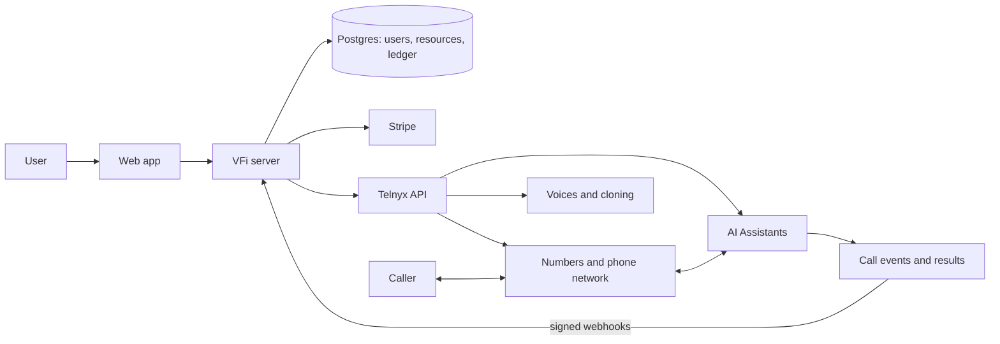

# VFi spec

What VFi does, the rules it follows and why. Last rewritten 2026-10-27 (English; the earlier Chinese version is in git
history, and [Appendix A](#appendix-a-old-section-numbers) maps its section numbers to this one).

## How to use this document

- **Who it's for:** the product owner, and any developer or coding agent working on VFi. Read
  [§1](#1-product) and [§2](#2-architecture) first; after that, read only the section for the feature you're touching.
- **What's here:** product rules, limits, and the reasons for them. Each feature section has the same parts:
  *Status*, *What it does*, *Rules*, *How it works*, and where relevant *Open questions*.
- **What isn't here:**
  - Telnyx API facts: [docs/telnyx-api-notes.md](docs/telnyx-api-notes.md).
  - ElevenLabs: [docs/elevenlabs-notes.md](docs/elevenlabs-notes.md).
  - Brand, audience, copy and pricing wording: [PRODUCT.md](PRODUCT.md).
  - Visual design: [DESIGN.md](DESIGN.md).
  - Setup, environment variables, daily jobs, code layout: [README.md](README.md).
- **Source of truth for numbers:** prices and limits live in `src/lib/config.ts`. This document names the config
  key next to each value. If the two disagree, the code is what runs; fix whichever one is wrong.
- **Status labels:**

  | Label | Meaning |
  | --- | --- |
  | **Built** | In the code on `main`. |
  | **Built, behind a flag** | In the code, off in production until the named flag is turned on. |
  | **Planned** | Approved, not built yet. Build it as written here. |
  | **Dropped** | Considered and decided against. Kept with the reason so it isn't re-proposed blindly. |
  | **Open** | Not decided or not verified. Don't treat it as approved. |

- **Words:** *Assistant* is the product feature users create (PRODUCT.md, Terminology). Code and Telnyx call it an
  *agent* or *assistant*; both mean the same thing here. *We* or *VFi* is our app. *Telnyx* is the voice platform
  underneath. *User* is a VFi customer; *caller* or *other party* is the person on the phone.
- **Keeping it current:** when a decision changes, edit the section it belongs to and add a line to the
  [decision log](#11-decision-log). Don't append dated sections at the end.

---

## 1. Product

### 1.1 What VFi is

A web app that gives a business a US phone number and an AI voice Assistant that answers and places calls. It wraps
Telnyx's numbers, calling and AI Assistants in one simple interface and adds accounts, billing and per-user
ownership. Audience, positioning and brand are in PRODUCT.md.

| Topic | Decision |
| --- | --- |
| Market | United States. US local numbers only. |
| Call languages | English and Mandarin, including mixed sentences. Each Assistant has a main language. Cantonese is deferred. |
| Interface languages | Five: en, zh, es, ja, vi. All UI text is translated into all five. |
| Provider | Telnyx, on one platform account that VFi owns. Users never see or touch Telnyx. |
| Goal | One complete loop (§1.2), kept simple. No industry-specific workflows. |

### 1.2 The core loop

> Sign up → add credit → get a number → pick or clone a voice → create an Assistant → link it to the number →
> answer or place calls → review results, usage and charges.

The order describes how the pieces depend on each other, not a fixed onboarding flow. Every step must also explain
its failures: a number order that fails, a clone that fails, an Assistant that won't start, a call that doesn't
connect, a payment that fails.

### 1.3 Principles

1. **Thin layer over Telnyx.** Numbers, calling, speech recognition, speech synthesis, LLM inference and Assistant
   orchestration all run on Telnyx. We don't build any of them.
2. **Behind an adapter.** Telnyx is reached only through the provider-neutral `VoiceProvider` interface
   (`src/server/telnyx/`), with a `live` and a `mock` implementation. Pages and business data never depend on Telnyx
   request or response shapes. The mock lets everything run without credentials.
3. **Pick, don't copy.** Expose only the Telnyx settings that solve a real problem for our users. A Telnyx feature
   existing is never by itself a reason to add it.
4. **Other providers only when needed,** and then through Telnyx's own integration points first: bring-your-own key
   (`llm_api_key_ref`), an OpenAI-compatible endpoint (`external_llm`), a fallback model (`fallback_config`), and
   third-party TTS in the Telnyx catalog. Keys go in Telnyx Integration Secrets; we store only their ids. Today the
   only one in use is ElevenLabs voices with the user's own key (docs/elevenlabs-notes.md).
5. **Settings sit next to what they serve.** A model choice sits beside the setting it powers; an email setting
   sits beside the feature that sends the email.
6. **UI rules:** all five interface languages; no ALL-CAPS text or uppercase styling; every UI change is shown to
   the product owner as a mock and approved before it's built.

### 1.4 Out of scope

| Item | Why | Decided |
| --- | --- | --- |
| Industry templates and workflows | Kept simple; templates cover common jobs only (§5.2). | 2026-10-07 |
| Our own speech, LLM or Assistant engine | Principle 1. | 2026-10-07 |
| More than one voice-agent platform | Principle 1. | 2026-10-07 |
| Sending texts (Assistant replies, user replies, scheduled texts) | US A2P texting from local numbers needs 10DLC registration, which we can't do now (§7). | 2026-10-16 |
| Bulk outbound calls, CRM, calendar, long-term memory, number porting, transfer to a person, IVR navigation | Not needed yet. Transfer, noise suppression (its cost is unknown) and "improve my instructions" (`/instructions/enhance`) may be revisited. Outbound voicemail detection was built in §9.3. | 2026-10-07, 2026-10-21 |
| Tool calls other than knowledge retrieval and hang-up | Not needed yet. | 2026-10-20 |
| Telnyx console sections Avatar, Workflow, Integrations (MCP, A2A), Messaging, Widget, Observability, Advanced; Calling's recording, TeXML and outbound settings | Pick, don't copy (principle 3). | 2026-10-21 |
| Testing an Assistant without a phone call: text test chat, saved tests, browser voice calls | Dropped by the product owner. Telnyx findings kept in the API notes §15. | 2026-10-27 |
| Pronunciation list and speech-recognition hint per Assistant | Dropped. Telnyx allows only 50 pronunciation dictionaries per organization, shared by all users. API notes §16. | 2026-10-27 |
| Draft and published versions of an Assistant | Dropped: without test chat a draft can only be tested by phone. API notes §14 records how it would work. | 2026-10-27 |
| Free trial credit | No free usage; every top-up goes through Stripe (§3.2). | 2026-10-07 |

---

## 2. Architecture

### 2.1 Who does what

| Telnyx provides | VFi provides |
| --- | --- |
| Number inventory, ordering, the phone network | The web interface and user accounts |
| Voices, voice cloning, speech synthesis | Ownership of numbers, voices, Assistants, calls, texts and knowledge |
| Running the Assistant: speech recognition, LLM, tools | Connecting user actions to the Telnyx API and keeping state in sync |
| Answering and placing calls, call events | Payments, eligibility, usage and charges |
| Transcripts, summaries, usage and cost data | Failure handling, event de-duplication, recovery |
| Storage buckets and retrieval for knowledge bases | Retention and deletion on our schedule |

### 2.2 System shape

Live audio never passes through our server; we handle configuration, permissions, events and business data.

### 2.3 Stack

Next.js (App Router, TypeScript), React, Tailwind, next-intl, Postgres with Drizzle ORM, hosted on Vercel. Stripe
Checkout for payments, Resend for email. Locally, Telnyx webhooks reach the dev server through ngrok. Details:
README.md.

### 2.4 Data and ownership

| Object | Must record |
| --- | --- |
| User | Identity; owns everything below |
| Phone number | Owner, Telnyx number id, order status, linked Assistant |
| Voice | Owner (or platform-wide), Telnyx voice id, type, status |
| Assistant | Owner, Telnyx assistant id, configuration, voice |
| Call | Owner, Assistant, our number, Telnyx call and conversation ids, status, results |
| Text message | Owner, our number, sender, content, segments |
| Knowledge source | Owner, Assistant, Telnyx bucket and object keys, type, processing status (§8) |
| Payment | Owner, Stripe id, status |
| Ledger entry | Owner, resource or call, amount, reason |

Rules:

- Every read and write checks ownership in our database. Users never see each other's resources
  (`tests/isolation.test.ts`).
- We keep the mapping between our ids and Telnyx ids, so we can sync and could one day switch providers.
- Numbers, voices and Assistants are managed separately and linked; a number points to at most one Assistant.
- Telnyx's cost for a call or text is stored apart from what we charge the user, for reconciliation only. The
  account's total Telnyx bill is never attributed to a single user.

### 2.5 External operations and webhooks

- **Accepted is not done.** A request being accepted, a resource existing, the resource being ready, and the
  action succeeding are four different states. For example a number order must reach *active*, an Ultra clone must
  reach *active*, and an outbound call must be answered and its Assistant started.
- **Webhooks:** verify the Ed25519 signature on the raw body and reject timestamps older than 5 minutes; dedupe on
  the event id; expect duplicates and any order; fill gaps by querying the API. Never create a resource or charge
  twice because of a repeated event. All Telnyx webhooks (calls, texts, insights) arrive at `/api/webhooks/telnyx`.
- **The daily job** (`/api/cron/daily`, README.md) is the safety net for anything a webhook or page view missed. It
  runs once a day, so it is never the timely path.

### 2.6 Database changes: add tables, never columns

Preview deployments share the production database and don't run migrations, and Drizzle's `select()` lists every
column in the schema. A new column on an existing table therefore breaks production until the migration runs. So:

- New features add **new tables**; they don't add columns to existing ones.
- A new value in an existing enum is added with `ALTER TYPE … ADD VALUE`. Drizzle runs pending migrations in one
  transaction, and a new enum value can't be used inside the transaction that adds it, so no migration in the same
  batch may use it.
- Migrations run only on production builds. A feature that needs a new table errors on previews until it's merged
  and migrated; that's expected. (A charge that fails this way rolls back with its transaction, so nobody is
  charged twice.)

---

## 3. Accounts, billing and limits

**Status: Built.**

### 3.1 Sign-in

Email one-time codes and Google sign-in. No passwords.

### 3.2 Balance and payments

- Prepaid balance only. Users top up through Stripe Checkout (minimum $10, `MIN_TOPUP_CENTS`; maximum $500,
  `MAX_TOPUP_CENTS`). No subscriptions.
- Number rent, calls, clones, knowledge sources and texts are all taken from the balance.
- No free credit. Production has no way to add balance except Stripe. Development has a dev-only "add balance" tool,
  recorded as an adjustment rather than a payment and disabled in production builds.
- Amounts are integer cents. Every change is an entry in an append-only ledger (`src/server/billing/ledger.ts`), the
  only way the balance changes; entries are idempotent.

### 3.3 Prices

Fixed retail prices, configurable. Telnyx's cost is recorded separately and never used as the user's price.

| What | Price | Config key |
| --- | --- | --- |
| Call, in or out | $0.15 per minute, rounded up | `PRICE_CALL_PER_MINUTE_CENTS` |
| Phone number | $3.00 per 30 days, first month charged at purchase | `PRICE_NUMBER_MONTHLY_CENTS` |
| Voice clone (Telnyx) | $5.00 each | `PRICE_VOICE_CLONE_CENTS` |
| Knowledge source | $1.00 each, any type (§8) | `PRICE_KNOWLEDGE_SOURCE_CENTS` |
| Received text | $0.02 per segment (§7) | `PRICE_SMS_INBOUND_PER_PART_CENTS` |
| ElevenLabs clone with the user's own key | Free on our side | — |

### 3.4 When the balance runs out

| Balance | Effect |
| --- | --- |
| ≤ 0 | No outbound calls, incoming calls are rejected, no buying numbers, clones or knowledge sources. Texts are still received and charged (they can't be refused). |
| Any purchase | The balance must cover the full price; a purchase never takes the balance below zero. |
| Negative for more than 7 days (`NEGATIVE_BALANCE_RELEASE_DAYS`) | Numbers are released and can't be recovered. Knowledge sources are kept. |

### 3.5 Limits per user

| Limit | Value | Where |
| --- | --- | --- |
| Phone numbers | 3 (§9.1) | `limits.numbersPerUser` |
| Assistants | 3 | `limits.agentsPerUser` |
| Cloned voices | 2 | `limits.clonedVoicesPerUser` |
| Calls at the same time | 1 per number, so up to 3 per account (§9.1) | `hasOtherActiveCall` (a rule, not a setting) |
| Knowledge sources | 5 across all Assistants; 5 added per 24 hours (§8) | `limits.knowledgeSources`, `limits.knowledgeAddsPerDay` |

---

## 4. Phone numbers

**Status: Built.** Up to 3 numbers per account, each its own line: §9.1.

- US local numbers only (no toll-free), searched by area code, by the last 1–4 digits ("Ends with", Telnyx
  `filter[phone_number][ends_with]`), or both. Nearby area codes are offered when the code is sold out. When no
  number in the area code has the ending, the search runs again across the US and says so. Results that don't
  end in the digits are dropped. Telnyx trial accounts can't use this filter (error 10039, shown as "not available
  on this account"); production is a paid account. Mock mode: area code 998 has no numbers, 999 only nearby ones.
- Buying charges the first month up front; renewal is charged every 30 days by the daily job. A number order is
  pending until Telnyx reports it active; a failed order is refunded.
- Each number has at most one Assistant. Without one, calls to it are rejected.
- Numbers receive texts as well as calls (§7).
- Releasing a number is permanent.
- Outbound calls only go to US numbers. The app refuses Canadian, Caribbean and premium-rate numbers, and the
  Telnyx outbound profile allows only US destinations as a backstop (README.md).

---

## 5. Assistants

**Status: Built.**

### 5.1 Settings

The Assistant page has four parts, in the order a user sets things up. Everything except name, voice, greeting and
instructions has a default.

| Part | Settings |
| --- | --- |
| Basics | Name, main language, voice (with a preview and the speech model it uses), speaking rate (0.8–1.2×), background sound (none / office) |
| Instructions | Greeting, instructions (both can use variables), variables, time zone, language model |
| Conversation | Response timing (fast / medium / patient = wait 0.4 / 0.8 / 1.2 s), whether the caller can interrupt, whether the greeting can be interrupted, key terms (with the speech-recognition model shown) |
| Ending the call | Hang up when the conversation is over (on by default; Telnyx `hangup` tool), maximum call length (5 / 10 / 15 / 30 min, default 30), hang up after silence (never / 30 / 60 s, default 60) |

Below these: the knowledge base (§8) and deleting the Assistant.

### 5.2 Templates

- A new Assistant starts from a template: Reception, Business Q&A (turns on the knowledge base), Outreach, or Blank
  (`reception`, `qa`, `outreach`, `blank` in `src/lib/agent-templates.ts`).
- A template only pre-fills the form (name, language, greeting, instructions, variables, call behavior). After
  creation the Assistant has no link to it. Telnyx has no template API, so templates live in our code.
- Template names and descriptions are translated into the five interface languages. Greetings and instructions are
  what the Assistant reads, so they stay in their original language.

### 5.3 Variables

- **Built-in**, filled by us at the start of every call: `call_direction` (inbound / outbound), `call_goal`,
  `contact_number` (the other party), `current_time` (call start, in the Assistant's time zone). Telnyx's
  `telnyx_*` variables also work, but their date and time are UTC, hence `current_time`.
- **Custom:** up to 10. Names use lowercase letters, digits and underscores, can't repeat a built-in name, and can't
  start with `telnyx_`. Values up to 500 characters. A variable must have a value unless it's marked "fill in on
  each call".
- "Fill in on each call" variables appear on the outbound call form; left empty, the default is used. The value is
  stored on the call, like the call goal.
- Every call passes every variable's value explicitly, because Telnyx doesn't apply the defaults stored on the
  Assistant (API notes §9).
- If the greeting or instructions use a `{{name}}` that no variable provides, the page shows a warning but still
  saves.

### 5.4 Calls in both directions

- Every call passes `{{call_direction}}`. For outbound calls the user can enter a goal for that call only, passed
  as `{{call_goal}}`. How the Assistant uses them is up to the user's instructions; default instructions cover both
  directions.
- The greeting on inbound calls always starts with the recording notice (§6.3).
- Outbound calls use a fixed opening that says it's an AI and that the call may be recorded ("Hi, this is an AI
  assistant calling. This call may be recorded." or the Mandarin equivalent). The Assistant's own greeting is for
  inbound calls only.

### 5.5 Models and voices

The platform fixes speech recognition and cloning; users choose the voice and, optionally, the LLM.

| Part | Choice | Why |
| --- | --- | --- |
| Speech recognition | `assemblyai/universal-3-5-pro`, language `auto` (`TELNYX_STT_MODEL`, `TELNYX_STT_LANGUAGE`) | On live calls (2026-10-07) it handled English, Mandarin and mixed sentences. `deepgram/nova-3` on `auto` heard Mandarin as English words. |
| LLM default | `zai-org/GLM-5.2` (`TELNYX_LLM_MODEL`), set explicitly rather than relying on Telnyx's default | In a 2026-10-26 comparison of 15 models on the Front Desk test set it answered everything correctly, searched the knowledge base whenever needed, and was fast. It replaced Kimi-K2.6, which searched only two-thirds of the time and made up a price on a real call. Details: API notes §8. |
| LLM per Assistant | One of five: GLM-5.2, GLM-5.3-Flash, gpt-5.4-mini, gpt-5.2, gpt-6-luna (`OFFERED_MODEL_IDS`) | A listed model is hidden if Telnyx stops recommending it, has no price, or charges more than $15 per million output tokens, since calls are billed per minute. |
| Voice | Per Assistant, from the live Telnyx catalog | Mandarin voices exist only on Telnyx Ultra; the default voice, Hua, is an Ultra voice that reads Mandarin and English naturally and is labelled "Mandarin + English". KokoroTTS voices read English only, are labelled "English only", can't be used by a Mandarin Assistant, and make the Assistant reply only in English. |
| Cloning | Telnyx `Qwen3TTS` (`TELNYX_CLONE_MODEL`); or ElevenLabs with the user's own key | — |

When platform model settings change, existing Assistants are re-synced automatically (§5.7).

### 5.6 Voice cloning

- The user uploads or records a sample and confirms "this is my voice, or I have the speaker's consent". We store
  the time of that confirmation. Telnyx has no consent field, so this is our responsibility.
- Telnyx clones only work once the platform account passes Telnyx's L2 verification, so Telnyx cloning is behind
  `VOICE_CLONING` (off by default in live mode).
- ElevenLabs cloning with the user's own key is separate (`ELEVENLABS` flag, needs `SECRETS_KEY`):
  docs/elevenlabs-notes.md.

### 5.7 Keeping Telnyx in sync

- Saving an Assistant pushes its whole configuration to Telnyx. Edits made in the Telnyx portal are overwritten on
  the next sync.
- Each push records a fingerprint of what was sent (platform settings including `ASSISTANT_BODY_VERSION`, the
  knowledge-base flag and the Assistant's expected knowledge state) in `agents.synced_config`.
  `resyncStaleAgents` compares the expected fingerprint with the stored one and re-pushes any that differ. It runs
  from the daily job and when the owner views their Assistant pages, but only on the production deployment:
  previews share the database and Telnyx account and would otherwise push their own settings over production's.
- Every push sends `tools` (Telnyx replaces the whole tool list when it's sent and keeps it when omitted): only
  the tools we want (hang-up, retrieval), or an empty list.
- A background re-sync never changes the Assistant's status. If it fails, the Assistant keeps running on its
  previous Telnyx configuration and the next attempt retries it. Failure handling when the user saves is in §8.4.

---

## 6. Calls

**Status: Built.**

### 6.1 Flow

- **Inbound:** Telnyx sends `call.initiated` to our Call Control app. We check ownership, the linked Assistant and
  the balance, then either answer with the Assistant (passing its id and the call's variables) or reject.
- **Outbound:** the user picks an Assistant, enters the number and an optional goal, and (with several numbers) the
  number to call from; we dial from it. When the call is answered we start the Assistant with the fixed outbound
  opening.
- **Busy:** each number has one call at a time; a second call to or from a busy number is rejected or refused. Calls
  on the account's other numbers aren't affected (§9.1).
- **Billing:** on hangup, per started minute at the call price. Telnyx's own cost for the call
  (`call.cost` webhook) is stored for reconciliation.

### 6.2 Results

- Each call has a recording (dual channel, MP3, made by our answer or dial command; the Assistant's own recording is
  turned off because it duplicated outbound recordings), a transcript and a summary.
- **Summary:** comes from the Assistant's own insight group (§9.2), with our summary instructions in the
  Assistant's main language. Until that group is set up (or if setting it up fails), the Assistant uses
  `TELNYX_INSIGHT_GROUP_ID` when set, otherwise the default group Telnyx gives every account.
- **Waiting for results:** the transcript is fetched right after the call; the summary can take about 30 s. A call's
  results are final when the summary is complete or `RESULTS_WAIT_MS` (30 min) has passed; until then the call page
  and the daily job keep asking. A failed summary never loses the transcript.

### 6.3 Recording notice and retention

- Calls are recorded. The inbound greeting starts with a recording notice, and the outbound opening says so.
- Recordings, transcripts, summaries and the Telnyx conversation are deleted 30 days after the call
  (`RETENTION_DAYS`) by the daily job. Users can delete a call record themselves sooner.

---

## 7. Texts (receive only)

**Status: Built** (2026-10-16). Live mode needs `TELNYX_MESSAGING_PROFILE_ID`; without it texting is off.

### What it does

People can text a user's number. VFi stores the texts, groups them by sender, marks unread ones and shows them on the
Messages page. Typical uses: verification codes, a message from someone who couldn't get through.

### Rules

| Topic | Rule |
| --- | --- |
| Sending | **Never.** No Assistant replies, no user replies, no scheduled texts. US A2P texts from local numbers need 10DLC registration, which we can't do now. We never call `POST /v2/messages`. The numbers page says "receives texts, can't reply". |
| Numbers | Every number gets texting when it's bought; numbers bought earlier are added by the daily job. |
| Price | $0.02 per segment (`parts` in the webhook). Telnyx charges $0.004 per segment plus up to $0.0045 carrier fees, and possibly about $0.010–0.012 for unregistered (non-10DLC) traffic; 1¢ could lose money, so 2¢. The number's texting fee ($0.10/month at Telnyx) is covered by the number rent. |
| Balance ≤ 0 | Texts can't be refused, so they are still received, stored and charged; the negative-balance release rule applies as usual. |
| Content | Text, sender, time and segment count. For MMS we record only that there were attachments and how many; we don't download them (their links expire after 30 days, and storing them adds cost and review burden). |
| Retention | Same as calls: deleted after 30 days; users can delete sooner. |

### How it works

- We **don't** use the AI Assistant `messaging` feature: an Assistant with it replies to texts, which is sending.
  Synced Assistants never have `messaging` in `enabled_features`.
- One platform messaging profile with its webhook at `/api/webhooks/telnyx`. Numbers are put on it when they
  activate (`PATCH /messaging_phone_numbers/{number}`).
- `message.received`: verify the signature, dedupe on the event id, find the owner by the receiving number, store,
  charge.
- Code: `src/server/messages.ts`; table `messages`; ledger kind for received texts. In mock mode the numbers page has
  "Simulate an inbound text", which goes through the real webhook path.

### Open questions

Drafted for Telnyx support in docs/telnyx-support-questions-messaging.md (not sent yet):

- Do unregistered local numbers reliably receive texts from every carrier? (Expected yes; 10DLC limits sending.)
- Can one number be on both the Call Control app and the messaging profile?
- Does Telnyx auto-reply to STOP / HELP, which would be sending, and can it be turned off?
- Telnyx's real cost of receiving, and whether the profile needs extra verification.

---

## 8. Knowledge base

**Status: Built, behind a flag** (2026-10-20). `KNOWLEDGE_BASE=on|off` (default on in mock, off in live);
website sources also need `KNOWLEDGE_BASE_URLS=on|off` (same defaults).

### 8.1 What it does

Each Assistant can have its own knowledge base of typed text, files and one website, which it searches during
calls using Telnyx's hosted retrieval (storage bucket + embeddings + `retrieval` tool). It's managed in the
Knowledge section of the Assistant page; there's no separate page.

| Included | Not included |
| --- | --- |
| One knowledge base per Assistant | Sharing sources between Assistants (add them to each) |
| Typed text; TXT, MD and PDF files; one website per Assistant (Telnyx crawls the site's pages) | DOCX; HTML, CSV and JSON files (Telnyx supports them; add when asked); audio and video; OCR of scanned PDFs |
| Usage mode per Assistant: off / reference / strict | Editing, renaming or replacing a source (delete and add again); re-crawling a website |
| Status per source (processing / ready / failed) with the reason; deleting a source | Showing retrieved passages on the call page |
| One-time charge per source; refund if processing fails | Monthly fees, usage-based fees |

### 8.2 Rules

| Topic | Rule |
| --- | --- |
| Ownership | The knowledge base belongs to the Assistant. Deleting the Assistant permanently deletes it. |
| Usage mode | **Off:** no retrieval tool; sources are kept. **Reference:** answer from the knowledge base first, general knowledge otherwise. **Strict:** factual answers to the caller come only from the knowledge base, the instructions and this call's goal (`{{call_goal}}`); it doesn't stop the Assistant pursuing its instructions and goal, in either direction. In both modes, when it can't answer it says so and says the question will be passed on (through the call summary). Adding the first source sets the mode to Reference. |
| No usable sources | If the knowledge base is empty or every source failed, the Assistant still runs in its saved mode (and says so when it finds nothing); the page warns that there are no usable sources. |
| Counts and sizes | Up to 5 sources per user across all Assistants (processing and failed ones count; deleting frees the slot). Text: a title ≤ 80 characters and body ≤ 20,000 characters. TXT / MD: ≤ 500,000 characters. PDF: ≤ 4 MB and must start with a PDF header. One website per Assistant; if its crawled text exceeds 4 MB the source fails with "site too large, use a more specific page" and the crawled pages are deleted. At most 5 sources added per user per 24 hours (any type, counted from ledger charges; deleting or refunding doesn't give them back). All limits are checked under the user lock. |
| Price | Each source costs a one-time $1 from the balance, whatever its type (ledger kind `knowledge_source`). It can't be added if the balance doesn't cover it. A source that fails processing is refunded at the price charged, except a too-large website (the crawl has already cost us). Deleting a source is never refunded, even while processing. Ledger descriptions name only the source type and Assistant, never content, file name, URL or failure reason. |
| Deletion | No retention period: sources stay until the user deletes them or the Assistant. Deletion is immediate and permanent: the text, display name, URL, size and failure reason are cleared at once, the source disappears and frees its slot; then its Telnyx objects are deleted (all crawled pages, for a website), then the row. Until Telnyx cleanup finishes (including a crawl still running), the Assistant runs without the retrieval tool, so deleted content can't be read out. Cleanup is retried from the Assistant page and the daily job. Content already spoken on a call is part of that call's recording and transcript and follows the 30-day rule. |
| Failures | A failed source shows its own status only. Knowledge problems never put the Assistant into a failed state or stop its number answering (§8.4). Failure reasons (site too large, couldn't read the content, knowledge base slots full, upload failed) are stored messages translated into all interface languages; Telnyx's `error_reason` isn't shown ("couldn't read this source" instead). Logs record source ids and states only, never content, names or URLs. |
| Languages | Aimed at English and Mandarin sources. Other languages can be added without a promise about quality. Reply-language rules don't change. |
| Privacy note | The section warns that sources may be read out to callers, so don't add anything that shouldn't be shared. |

**Why $1 once.** Telnyx embedding costs $0.0015 per 1,000 characters (default model
`intfloat/multilingual-e5-large`); storage is $0.60 per GiB-month, about $0.01/month for a user's ~20 MB (assuming
extended retention has no fixed fee, §8.7); retrieval during calls is, per Telnyx's price page, part of its $0.05/min
voice AI fee (to be confirmed, §8.7). A typical source costs cents (a 20-page PDF of ~50,000
characters ≈ $0.08), and the cost falls when it's added, so there's no monthly fee. Worst cases within the limits:
text ≈ $0.03, TXT/MD ≈ $0.75. PDF text can be several times the file size and a crawl can't be limited or cancelled,
so neither is capped by size; the daily add limit, one website per Assistant and no refund for too-large sites cap
the daily risk per user. If retrieval turns out to be billed separately, consider a per-minute surcharge on calls by
Assistants with a knowledge base.

### 8.3 How it works

- **One bucket per Assistant,** created with its first source and deleted with the Assistant; it stays even when
  empty. Name `ev-kb-` + the Assistant id without hyphens (38 characters), region `us-central-1`, versioning off.
  Telnyx allows 100 buckets per account and retrieval can only be scoped by bucket, so users and Assistants can't
  share one; with 3 Assistants per user the limit could be reached by about 33 users (usually one per user). If
  creating a bucket hits the limit, the source fails ("knowledge base slots full") and is refunded. Ask Telnyx to
  raise the limit before we get close.
- **Storage calls** go through Telnyx's S3-compatible endpoint
  (`https://us-central-1.telnyxcloudstorage.com/<bucket>/<key>`), signed with the API key as SigV4 access key id.
  Our server builds the requests itself: no AWS SDK, no pre-signed URLs (they'd contain the API key), no browser
  uploads. Creating an existing bucket is treated as success, so creation can be retried (Telnyx's exact response to a repeat
  is still open, §8.7).
- **Writing:** object keys come from the source id (`src/<id>.txt` for text, TXT and MD; `src/<id>.pdf`), never from
  the display name. Files arrive through a server action (Vercel's 4.5 MB request limit applies). Typed text is
  stored in our database for display and written as a `.txt` object. Objects are never modified.
- **Adding:** under the user lock, check limits, insert the source (processing, with the price charged), insert the
  knowledge-base row if needed, and charge. Telnyx calls happen outside the lock. Status moves only
  `processing → ready / failed` with `UPDATE … WHERE status = 'processing'`, and only the winner of that update
  refunds, so the page and the daily job can't settle a source twice. A source (or its Assistant) deleted while
  processing becomes `deleting`; later results neither refund nor revert it, and its objects are still cleaned up.
- **Embedding:** right after creating the bucket, `POST /v2/ai/embeddings` on the empty bucket; when accepted we
  record `embedded_at`. If rejected, the source fails and is refunded, and the next add retries. From then on Telnyx
  embeds and removes objects by itself.
- **Status:** Telnyx has no completion callback. A file whose embedding status is blank counts as embedded; only an
  in-progress status counts as processing. A source still processing after an hour fails and is refunded. The
  Assistant page checks processing and deleting sources when opened (and auto-refreshes while any are processing);
  the daily job is the fallback.
- **Websites:** `POST /v2/ai/embeddings/url`. Telnyx's crawl status is useless (it says success immediately and
  never changes; API notes §13), so a crawl counts as finished once the bucket has had no new writes for
  `knowledgeCrawlQuietMs` (1 hour live, 5 s mock), counted from the later of submission and the newest page. Until
  then the source stays processing, and deletion and cleanup wait. Then we list the crawled objects once: over 4 MB
  of text fails (no refund) and deletes them; zero objects fails ("couldn't read content from this URL") with a
  refund; otherwise it's ready. Crawled pages are stored by Telnyx as ~2 MB plain-text chunks named
  `depth-<level>-<n>.txt` at the bucket root (never under `src/`), so every object outside `src/` belongs to the one
  website source and we don't track their keys. A new website can't be added until the previous crawl (even of a
  deleted source) has finished.

### 8.4 Keeping the Assistant in sync

- The Assistant gets one `retrieval` tool (its bucket, `max_num_results` 3) and our mode rules
  appended to its instructions only when: the mode isn't off, the bucket's embeddings are on, and no source is being
  deleted. Otherwise it has no retrieval tool. Adding, finishing or failing a source doesn't change what's pushed, so
  it doesn't trigger a sync.
- Knowledge-related syncs (mode change, embeddings turned on, a deletion starting or ending, background re-syncs)
  never change the Assistant's status: no "syncing", no "failed". On failure the Assistant keeps answering with its
  previous Telnyx configuration, the fingerprint stays stale, and the page says "knowledge base not active yet, will
  retry automatically".
- When the user saves and the push with the retrieval tool fails, we retry once without the tool and mode rules.
  If that works the Assistant is ready, with a no-knowledge fingerprint; if it also fails, the Assistant fails as it
  would without a knowledge base.

### 8.5 Deleting an Assistant

In the same transaction that deletes the Assistant, clear all its sources' text, names and URLs and mark sources and
knowledge base `deleting` (they stop counting toward the limit). Then, whether or not the Telnyx assistant delete
worked: delete every object in the bucket, turn off its embeddings, delete the bucket (even if embeddings were never
recorded as on), then delete the rows. Each step is retried by the daily job. A crawl still being submitted (no task
id yet, under an hour) or running is waited for first. If the knowledge tables don't exist yet (a preview), skip
this part.

### 8.6 Data and code

- Tables (new tables only, §2.6): `agent_knowledge` (Assistant id as key, mode, bucket, state ready/deleting,
  `embedded_at`) and `knowledge_sources` (user, Assistant, type, display name, text, URL, crawl task id, size,
  `price_cents`, state processing/ready/failed/deleting, failure reason stored as English text plus message key,
  timestamps). An Assistant with no `agent_knowledge` row is "off", so existing Assistants were unaffected.
- Ledger: `chargePurchase` / `refundPurchase` with idempotency keys `knowledge:<source id>` and
  `knowledge:<source id>:refund`, `ref_type` `knowledge_source` and `ref_id` the source id; refunds use the row's
  `price_cents`; the 24-hour add count uses entries of kind `knowledge_source` (refunds have kind
  `refund`). Six stored ledger messages by source type (`stored.ledgerKnowledgeText` / `File` / `Url` and their
  `…Refund`), with only the Assistant name as a parameter; ICU `select` isn't used because the translation tests
  would treat its options as placeholders.
- Billing page: a price card "Knowledge source {price} each" (shown while the flag is on), and the terms list the two
  exceptions: no refund for a too-large website, none for deleting a source.
- `ASSISTANT_BODY_VERSION` (part of the platform fingerprint, §5.7) was bumped once for the new `tools` handling.
- Tests cover: isolation (user B can't read or delete A's sources; B's Assistant only ever sends B's bucket; cleaning
  up A's crawl touches only A's bucket); the 5-source and 24-hour limits; charging, low balance, refunds at the
  original price, no refund for too-large sites or deletion while processing, single settlement when the page and
  the daily job race; crawls over the limit and with 0 pages; the body and `tools` sent for each mode; no retrieval
  tool while a deletion is pending; knowledge sync failures leaving status alone; the save-time fallback; the flag
  turning retrieval off; nothing left at Telnyx or in the database (except ledger entries) after deletion.
  `resetDb` covers the new tables.
- With the flag off, pages and sync don't query the new tables and the expected state is "no knowledge", so turning
  it off or on removes or restores the retrieval tool on the next sync; users can't delete single sources while it's
  off. Cleanup on Assistant deletion and the daily deletion retries always run.
- Mock mode simulates everything (buckets, objects, embedding over time, crawls). Content triggers failures: text
  containing `mock:unreadable` fails; URLs containing `too-large` or `empty` crawl over 4 MB or nothing. The bucket
  limit, delete failures and a rejected retrieval tool are only triggered from tests (`mockKnowledge`). Mock state is
  in memory, so after a dev-server restart a processing source fails and is refunded after an hour.

### 8.7 Open questions

Drafted for Telnyx support in docs/telnyx-support-questions-knowledge-base.md (not sent yet). Website sources stay
off in production (`KNOWLEDGE_BASE_URLS`) until the crawl billing question is answered. Our own test already found
no crawl limit beyond link depth, so turning them on means accepting that risk: the product owner decides.

- **Blocking:** without "extended retention", are embeddings deleted or disabled after 30 days? How is it turned on
  by API, and what does it cost? (Sources must last until deleted; a fixed monthly fee would change "no monthly
  fee".)
- **Blocking:** after an object is deleted, are its vectors deleted at once and for good? Does Telnyx keep deleted
  objects, vectors or crawl results anywhere, and for how long? "Delete means gone" depends on this; if vectors
  outlive objects, deleting a source would have to rebuild the bucket.
- **Blocking:** does creating or updating an Assistant fail when its retrieval tool points at an empty or
  processing bucket, and do calls still start?
- **Blocking for websites:** are crawled pages that we delete straight away still billed? A crawl has no page or
  size limit beyond about three links deep (one URL gave 12.5 MB; API notes §13).
- Before the bucket limit: can it be raised, or can retrieval be scoped by prefix or metadata inside a bucket? What
  error does creation return at the limit?
- Does `bucket_ids` take bucket names? What does creating an existing bucket return?
- Is retrieval called by the LLM or injected every turn, and what does it add to latency? Does it work on every
  offered model? Do retrieved passages appear in the conversation messages?
- Retrieval quality for English and Mandarin sources and questions; is `multilingual-e5-large` right?
- Is retrieval during calls billed separately? Which embedding price applies? Is there a per-document character
  limit (needed to cap PDF cost)?
- Status and `error_reason` for image-only PDFs; document size limit.
- Inline `tools` is deprecated: can `retrieval` be a shared tool (`tool_ids`), and will inline retrieval stop
  working?
- The exact steps to delete a bucket completely (and free its slot).
- Is the crawl's `depth-<level>-<n>.txt` naming stable? We rely on it: every object outside `src/` is treated as
  crawled.
- If an offered model can't use retrieval reliably, hide it or warn when the mode isn't off.

---

## 9. Round 2: more numbers and call results

**Status:** E and A are built. Approved 2026-10-26, revised 2026-10-27. Built in this order, one pull request
each, cut from `main`: **E (§9.1), then A (§9.2).** E is small and independent; A's email shows which of the user's numbers took
the call, which needs E.

Where it came from: setting up and rehearsing the Nyquiste Front Desk Assistant (7 real calls and 15 text scenarios
run twice each) and comparing our Assistant page with the Telnyx console.

| Item | Problem seen in rehearsal | Status |
| --- | --- | --- |
| E. Up to 3 numbers per account | One number per account: separate lines of business or separate Assistants can't each have a number | Built 2026-10-27 |
| A. Call-result fields and email | Every call gets only a generic summary, and nobody is told when a call comes in | Built 2026-10-27; mock approved 2026-10-27 |
| B. Testing without calls | Every instruction change needed a phone call to check | Dropped (§1.4) |
| C. Pronunciation and recognition | Instructions had to spell names out ("V Fi", "Air P P P"); "VFi" was heard as "Wi-Fi" | Dropped (§1.4) |
| D. Draft and published versions | The live Assistant was edited 9 times during rehearsal | Dropped (§1.4) |

### 9.1 E. Up to 3 numbers per account

**What it does**

- An account can have up to 3 numbers (`limits.numbersPerUser` 1 → 3). Each costs $3 per 30 days as usual; buying
  rules don't change.
- Each number still has at most one Assistant. One Assistant may answer several numbers.
- **Calls at the same time: one per number,** so up to 3 per account (decision 2026-10-27). Each number behaves as
  its own line: a second caller to a busy number is turned away as today; calls to the other numbers go through.
  The balance is checked at the start of each call; overlapping calls can take the balance below zero, as a call
  that runs out of balance already can.

**Screens** (mock approved 2026-10-27: https://claude.ai/artifact/8RaVCbVkD2YShZA2TJU1wt)

| Screen | Change |
| --- | --- |
| Numbers | One card per number, as today. With 3 numbers, a note replaces "Get a number": "You have 3 numbers, the most an account can have. Release one to get a different number." The page description says "up to 3 per account". |
| Calls: place a call | New "Call from" picker. Defaults to the selected Assistant's number (its earliest-bought one if it has several), otherwise the earliest-bought active number, and follows the Assistant when it changes. The caller-ID line shows the chosen number. |
| Calls: list | New "Your number" column and a filter by number. On phones, your number shows under the time. |
| Call details | New "Your number" line. |
| Messages | The description says "your numbers" instead of "your number". Each conversation shows which of the user's numbers it was sent to, with the same filter. A sender who texts two of the user's numbers appears as two conversations (grouped by sender and our number). |
| Dashboard | "Connect the Assistant to your number" becomes "Connect an Assistant to a number". With more than one number, the number card becomes a "Numbers" card listing each number and the Assistant that answers it, and every call in progress gets its own live banner, naming which of the user's numbers it is on. (Added after the mock, approved by the product owner 2026-10-27.) |
| Assistants list | An Assistant on several numbers lists all of them. |

All of these appear only when the account has more than one number; with one number the app looks as it does
today. All text in five languages.

**Rules**

- Can't call any of the account's own numbers (today only the "from" number is checked).
- The chosen "from" number must belong to the user and be active.

**How it works**

- The data model already supports several numbers (numbers are listed per user, linked per number, renewed per
  number). No new tables or columns.
- `startOutboundCall` takes an optional number id and checks it's the user's and active; without one,
  `defaultCallerNumber` (`src/lib/caller-number.ts`) picks it, and the call form uses the same rule for its default.
- `hasOtherActiveCall` checks per number instead of per account; one call per number is a rule, not a setting.
  Admission still runs under the per-user lock.
- The calls list and Messages take `?number=<number id>` to filter.
- Messages: conversations are keyed by (sender, our number). Thread links carry `to`; an old link without it shows
  all of the sender's texts.
- PRODUCT.md is updated (one call at a time per number).

### 9.2 A. Call-result fields and email

**What it does**

- **Fields:** each Assistant can define up to 8 things to record from every call. Each has a name, a short
  description (telling the model what to capture) and a type: text, one of a few options, or yes/no.
- **Template defaults:** Reception = call type, name, company, need, urgent. Business Q&A = question, answered,
  name, company. Outreach = goal reached, what was agreed, next step, and needs follow-up (a yes/no that drives the
  "Follow-up" badge). Blank has none.
- **Call page:** the fields appear as a table above the summary, with a line saying whether the email was sent and
  to whom. The calls list shows an "Urgent" or "Follow-up" badge when a yes/no field set to show it is yes; each
  yes/no field has its own setting (nothing / Urgent / Follow-up).
- **Mock:** https://claude.ai/artifact/LFXM1LoQyWGAVE7pqM1TcM (approved 2026-10-27). The settings are two cards
  after "Ending calls" on the Assistant page, saved with the rest of the form.
- **Email after each call:** optional per Assistant, **off by default**. Recipients default to the account email;
  the user can set up to 3 addresses instead. Any address is allowed, not just the account's domain: teams often
  use personal or shared inboxes, a real email only follows a call the user paid for, and test emails go only to
  the account email. The email holds the other party's number, our number (§9.1), the
  Assistant's name, the fields, the summary and a link to the call page, laid out by the email template.

**Email template**

- One template per Assistant, set up with the email switch and recipients. Without changes the default template is
  used, written in the Assistant's main language.
- **Subject:** one line, can use variables. Left empty, the default is used: "{{Assistant}}: call from
  {{Caller number}}", or "{{Assistant}}: call to {{Caller number}}" for calls the Assistant placed, in the
  Assistant's main language at the time of sending (so it follows a language change). The tag text works the same
  way. On calls the Assistant placed, the email labels the other party's number "Number called" instead of
  "Caller". The settings preview shows a call the Assistant answered.
- **Opening note:** optional paragraph at the top (for example "Please call back within 2 hours").
- **What's included:** checkboxes for caller number, call time and length, fields table, summary, call page link.
  The order is fixed.
- **Urgent tag:** optional text put before the subject (default "[Urgent]") when a chosen yes/no field is yes.
- **Variables:** Assistant name, caller number, our number, call time, call length, and each field by name. An empty
  field becomes "—". The available variables are listed as buttons; clicking one inserts it where the cursor is in
  the subject or note. Built-in variables work by their English or Chinese name. An unknown variable shows
  a warning (saving still works) and becomes empty when sent. A field that is deleted or renamed is treated as
  unknown, and the settings show a warning.
- **No custom HTML.** The body is plain text in our fixed layout, so it renders the same in every mail app, nothing
  unsafe gets in, and the call link always works. Variable values are escaped before they're inserted.
- **Preview and test:** the settings show a preview built from sample data, and "Send me a test email" sends one to
  the account email (at most 5 per Assistant per hour).

**Rules**

- Email only for calls the Assistant actually answered or placed; not for calls rejected for low balance or never
  connected.
- Summary and fields are written in the Assistant's main language.
- Fields apply to calls that start after they're set up or last changed; earlier calls get no field results.
  Likewise the email goes only for calls that start after it was turned on.
- Field results, and the badge they give, follow the 30-day retention like the summary. Emails never include the recording or full
  transcript.
- If the summary or fields aren't ready within `RESULTS_WAIT_MS`, or Telnyx reports that they failed, the email
  still goes, saying the summary isn't available.
- The sender is the same as for sign-in emails (Resend; no own domain yet).

**How it works**

- **Insights:** each Assistant gets its own Telnyx insight group with a summary insight plus, when it has fields, a
  structured insight whose `json_schema` is built from the fields. Telnyx requires strict schemas
  (`additionalProperties: false`, every property in `required`), so every field is nullable and empty when the call
  didn't cover it. Field keys are stable ids (`f…`), so renaming a field keeps its results. Insights run on
  Telnyx's default insight model (`zai-org/GLM-5.3-Flash`), under a cent per call. Our summary instructions ask for
  the Assistant's main language. The group is linked with `insight_settings.insight_group_id`.
- **Keeping the group in step** (`ensureInsights` in `src/server/call-results.ts`): every push of the Assistant
  first makes its insight group match its fields and language, updating the insights in place (a group that has
  gone missing is made again). A hash of what the group was set up from is part of the Assistant's sync
  fingerprint, so a change is retried until it succeeds. If setting up the group fails, the Assistant is still
  saved and keeps its previous group; it shows as stale and the next sync retries. Existing Assistants get their
  group on the first sync after this ships (their fingerprint no longer matches).
- **Results:** keep the wait logic from §6.2: results are final when the insights are complete or
  `RESULTS_WAIT_MS` has passed. `getCallResults` picks the summary and fields by insight id; calls from before the
  Assistant had its own group take the first completed insight as the summary.
- **Sending:** the write that makes a call's results final inserts its `call_results` row; only the request that
  inserts it sends the email (the page, the daily job and the webhook can all race). The row records "off",
  "sent" or "failed" and who it went to. A failed email isn't retried; one still "pending" after 10 minutes (the
  server stopped mid-send) is shown as failed.
- **Test emails** use the settings on screen (saved or not) and sample answers, go to the account email, and are
  limited to 5 per Assistant per hour (timestamps kept on the settings row).
- **Timely trigger:** the insight group's webhook. When all of a call's insights finish (or finally fail), Telnyx
  sends one signed `conversation_insight_result` with the conversation id and results by insight id (API notes
  §10). `/api/webhooks/telnyx` receives it, fetches and stores results, and sends the email. Opening the call page
  and the daily job remain the fallback, including the "summary not available" email after `RESULTS_WAIT_MS`.
- **Templates:** variable substitution happens on our server, in one function shared by preview, test email and
  real email, with its own tests. Everything the email says that depends on the Assistant's language (default
  subject and tag, labels, date format, sample answers) is in one table in `src/lib/call-email.ts`, so adding a
  language is one entry there.
- **Data** (new tables only, §2.6): `agent_call_results` (fields, email settings, the insight ids and hash, test
  email times) and `call_results` (per call: the fields as they were, the values, the badge, the email status).
  Retention and deleting a call clear the fields and values; deleting an Assistant deletes its insight group.
- **Checked on a real call (2026-10-27):** the insight webhook arrived and the email went out under a minute after
  hang-up, with no page open.

### 9.3 Voicemail on calls the Assistant places

**Status:** Built 2026-10-31; mock approved 2026-10-31 (https://claude.ai/artifact/5PVHF1Fd5w47QpqUFPBmZN). Not yet
checked on a real call (see How it works).

Before this, an Assistant that called someone and reached voicemail talked to the recording until the call ended.

**What it does**

- One setting per Assistant, in the "Ending calls" card: **If a call it places reaches voicemail**
  - **Hang up:** hangs up without saying anything.
  - **Leave a message, then hang up:** waits for the beep, says the user's message word for word in the
    Assistant's voice, and hangs up.
  - **Keep talking:** carries on as if a person answered; only recorded as reaching voicemail.
- **Calls pages:** in the list, "Reached voicemail" takes the place of the status, with what the Assistant did
  under it (Hung up, Message left, Kept talking). The call page says the same in a sentence.

**Rules**

- Hang up is the default, for new Assistants and for Assistants saved before the setting existed.
- The message is fixed text, required for Leave a message, at most `MAX_VOICEMAIL_MESSAGE_LENGTH` (500)
  characters (`src/lib/agent-settings.ts`).
- Only calls the Assistant places. Inbound calls are not affected; the "Place a call" form doesn't change.
- **Billing:** a voicemail call is billed like any connected call, for the seconds connected. Telnyx charges
  $0.0065 per placed call for detection (Premium AMD); VFi absorbs it.
- **Results:** calls that hung up or left a message get no call-result fields and no email (§9.2): there was no
  conversation. Keep talking calls are reported as usual, since detection can mistake a person for a machine.

**How it works**

- Every outbound dial asks for `answering_machine_detection: "premium"`. The Assistant's
  `telephony_settings.voicemail_detection.on_voicemail_detected` is set from the choice: `stop_assistant`,
  `leave_message_and_stop_assistant` with `voicemail_message {type: "message", message}`, or `continue_assistant`.
  `ASSISTANT_BODY_VERSION` 7 re-syncs existing Assistants so they carry it.
- Stopping the Assistant doesn't end the call, so VFi hangs up itself: on `call.machine.premium.detection.ended`
  with `result: "machine"` for Hang up, and once the Assistant has finished (`call.conversation.ended`) for Leave
  a message.
- Both webhooks may arrive in either order, so each fills in its half of one row in its own table,
  `call_voicemail` (§2.6): `action` (the Assistant's setting when voicemail was detected) and
  `assistant_ended_at`. Whichever completes the pair for Leave a message hangs up. A row without an action is a
  call that didn't reach voicemail.
- If detection is processed before the answer, the Assistant isn't started on a call being hung up.
- **Unconfirmed:** Telnyx documents `voicemail_detection` for dial plus assistant; VFi starts the Assistant with
  `ai_assistant_start` after the answer (§5.4). Whether Telnyx applies the setting that way, and whether
  `call.conversation.ended` arrives after the message is fully played, needs a real call to voicemail. If it
  doesn't apply, Hang up still works (VFi hangs up on detection); Leave a message would need VFi to stop the
  Assistant and speak the message itself.
- Mock mode: numbers ending in 1111 reach voicemail.

---

## 10. Open questions

Grouped here so nothing gets lost; details are in the linked sections.

| Question | Blocks | Where |
| --- | --- | --- |
| Telnyx support questions on knowledge bases (retention, vector deletion, empty buckets, crawl billing) | Turning the knowledge base and website sources on in production | §8.7 |
| Telnyx support questions on receiving texts (STOP/HELP auto-replies, cost) | Nothing; texting is live | §7 |
| Is AI inference included in the `call.cost` webhook's cost parts? | Reconciliation accuracy | API notes §6 |
| Does Telnyx's voicemail setting apply when the Assistant starts after the answer? | Trusting "Leave a message" | §9.3 |

---

## 11. Decision log

Newest first. Each line points to where the rule now lives.

| Date | Decision | Section |
| --- | --- | --- |
| 2026-10-31 | Number search by the last 1–4 digits, widening to the whole US when the area code has none | §4 |
| 2026-10-31 | Voicemail on calls the Assistant places: hang up (default), leave a fixed message, or keep talking; billed as usual; no results email except for Keep talking | §9.3 |
| 2026-10-27 | Emails for calls the Assistant placed say "call to" and "Number called"; insight webhook confirmed on a real call | §9.2 |
| 2026-10-27 | Kept from the A build: Outreach's "needs follow-up" field, a badge setting per yes/no field, no retry for failed emails, deleting an Assistant deletes its insight group; recipients may be any address | §9.2 |
| 2026-10-27 | A built: call-result fields, badges and the email after each call, from a mock approved the same day | §9.2 |
| 2026-10-27 | Rewrote this spec in English, organized by feature | — |
| 2026-10-27 | Each number takes one call at a time; up to 3 calls per account | §9.1 |
| 2026-10-27 | Up to 3 numbers per account (E); E mock approved | §9.1 |
| 2026-10-27 | Dropped draft and published versions (D) | §1.4 |
| 2026-10-27 | Email template per Assistant; plain text in a fixed layout, no custom HTML | §9.2 |
| 2026-10-27 | Dropped test chat, saved tests and browser voice tests (B), and pronunciation and recognition hints (C) | §1.4 |
| 2026-10-26 | Round 2 approved: call-result fields and email off by default, recipients configurable (up to 3), results in the Assistant's main language, email only for calls the Assistant handled | §9.2 |
| 2026-10-26 | Default LLM changed from Kimi-K2.6 to GLM-5.2; five models offered per Assistant | §5.5 |
| 2026-10-21 | Assistant templates, variables and call-behavior settings; background re-syncs never change an Assistant's status | §5 |
| 2026-10-20 | Knowledge base on Telnyx RAG, per Assistant, 5 sources per user, $1 each, deletion is permanent | §8 |
| 2026-10-16 | Receive texts only; never send. $0.02 per segment | §7 |
| 2026-10-08 | Mandarin voices only on Telnyx Ultra; Hua is the default | §5.5 |
| 2026-10-07 | MVP decisions: platform Telnyx account, email codes and Google sign-in, Stripe prepaid balance, prices, eligibility, recording and 30-day retention, Next.js + Postgres + Vercel, speech recognition on AssemblyAI | §1–§6 |

---

## 12. References

Telnyx documentation used for the original research (2026-10-07). Always check against current docs and real API
responses; API details we rely on are in docs/telnyx-api-notes.md.

- Number search: https://developers.telnyx.com/docs/numbers/phone-numbers/number-search
- Number orders: https://developers.telnyx.com/docs/numbers/phone-numbers/number-orders
- AI Assistant quick start: https://developers.telnyx.com/docs/inference/ai-assistants/no-code-voice-assistant
- Voice clone parameters: https://developers.telnyx.com/docs/voice/voice-design-lab/clone-voice/parameters
- Using cloned voices: https://developers.telnyx.com/docs/voice/voice-design-lab/using-custom-voices
- Transcription settings: https://developers.telnyx.com/docs/inference/ai-assistants/transcription-settings
- Available TTS voices: https://developers.telnyx.com/docs/voice/tts/available-voices
- Starting an Assistant on a call: https://developers.telnyx.com/docs/voice/programmable-voice/ai-assistant-start
- Dial: https://developers.telnyx.com/api-reference/call-commands/dial
- Scheduled events: https://developers.telnyx.com/docs/inference/ai-assistants/scheduled-events
- Voice AI pricing: https://telnyx.com/pricing/voice-ai-agents

---

## Appendix A. Old section numbers

Older documents and commits refer to the Chinese spec's section numbers. They map to this version as follows.

| Old | New |
| --- | --- |
| §1 Purpose | How to use this document |
| §2 Positioning, §4 Capabilities, §5 Core loop | §1.1, §1.2 |
| §3 Technical approach (incl. §3.6, §3.8) | §1.3 |
| §6 Responsibilities, §7 System structure | §2.1, §2.2 |
| §8 Resources and data | §2.4 |
| §9 State sync and billing (§9.2 events) | §2.5 |
| §10 Out of scope, §19.4 | §1.4 |
| §11 Research status, §12 Open items, §13 Completion criteria (§13.8 isolation), §15 Maintenance | Superseded; isolation is §2.4 |
| §14 References | §12 |
| §16 MVP decisions | §3 (billing, limits), §5 (models, cloning), §6 (recording, retention), §2.3 (stack) |
| §17 Texts | §7 |
| §18 Knowledge base (§18.2 rules, §18.3 how it works, §18.4 release, §18.5 open questions, §18.6 implementation) | §8 (§8.2, §8.3–§8.5, §8.6, §8.7, §8.6); the new-tables rule is §2.6 |
| §19 Templates and settings | §5.1–§5.3 |
| §20 Round 2 (§20.1 A, §20.9 E, §20.2–§20.4 dropped, §20.6 Telnyx checks, §20.7 decisions) | §9 (§9.2, §9.1), §1.4, API notes §10 and §14–§16, §11 |
